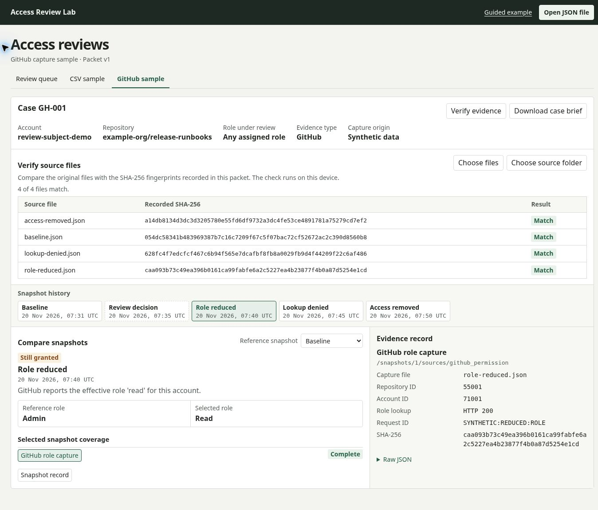

# Access Review Lab

Access Review Lab replays an identity and access management (IAM) offboarding review from timestamped exports or GitHub role captures. It checks whether a former employee's account still has a repository role and links each finding to the source records. The bundled cases use synthetic data.

[Review workspace](https://xzl7v.github.io/access-review-lab/) · [Guided example](https://xzl7v.github.io/access-review-lab/guide.html) · [GitHub capture demo](https://xzl7v.github.io/access-review-lab/viewer.html#github) · [Evidence packet](docs/evidence.json)



## Quick start

Requires Python 3.10 or later. The CLI uses the Python standard library.

```sh
git clone https://github.com/xzl7v/access-review-lab.git
cd access-review-lab
python3 replay.py
python3 replay.py --verify docs/evidence.json
```

The replay prints one verdict per snapshot and the source references for any matching grant path. Use `--scenario PATH` to review a different input. An invalid scenario or mismatched evidence packet exits with status `2`.

## Use the review workspace

The workspace opens a queue of five synthetic reviews covering scenario files, CSV exports, and GitHub captures. Filter by outcome and search by case, account, repository, or evidence. **Export filtered CSV** downloads the follow-ups currently shown in the queue.

Select a case and use **Snapshot history** to inspect individual captures and the recorded decision. **Reference snapshot** sets the comparison point. For GitHub captures the workspace shows the two effective roles. For grant exports it compares the cited access paths and opens the records behind each change. A path appears as **No longer observed** when a complete selected source omits one of its required records. **Unresolved** means the records are insufficient to confirm that change.

The evidence pane shows source fields and fingerprints where available. Expand **Raw JSON** to read the original record. **Download case brief** exports the selected snapshot, decision, and source coverage as Markdown. The same controls work with local files opened through **Open JSON file**.

### Verify source files

Open a GitHub capture or CSV packet with provenance and select **Verify evidence**. Choose the original source files together, or choose the folder containing the capture manifest to preserve relative paths when filenames repeat. The browser recalculates SHA-256 from the file bytes and reports each match, mismatch, missing file, or ambiguous filename locally.

Use `replay.py --verify` with the original inputs to replay the review and compare the full evidence packet.

## Review GitHub access

Capture one account's effective role on one GitHub.com repository before and after a removal decision. A role downgrade to `Read` still grants repository access. An explicit `none` response for the same account and repository IDs verifies removal. An unavailable response, including HTTP 403 or 404, leaves the finding at **Needs evidence**.

Replay the bundled captures with Python 3.10+.

```sh
python3 replay.py --github examples/github/manifest.json --output output/github-evidence.json
python3 replay.py --github examples/github/manifest.json --verify output/github-evidence.json
```

Open the packet in the Evidence Viewer to compare the baseline with each follow-up and inspect its request status, GitHub request ID, and SHA-256 capture fingerprint. [GitHub capture demo](https://xzl7v.github.io/access-review-lab/viewer.html#github)

### Collect a case

Use a fine-grained token scoped to a repository you administer, with **Metadata (read)**. Load it into the local `GITHUB_TOKEN` environment variable. The collector reads repository metadata and the account's effective permission through GitHub's REST API. [GitHub permissions endpoint](https://docs.github.com/en/rest/collaborators/collaborators#get-repository-permissions-for-a-user)

1. Capture the baseline after the employee's departure and before recording the removal decision.

   ```sh
   python3 github_capture.py --repository OWNER/REPO --account LOGIN --output output/github/baseline.json
   ```

2. Record the decision and apply the removal through your normal GitHub administration workflow. Capture a fresh follow-up afterward.

   ```sh
   python3 github_capture.py --repository OWNER/REPO --account LOGIN --output output/github/follow-up.json
   ```

3. Copy the [example manifest](examples/github/manifest.json) to `output/github/manifest.json`. Set the case details and reference your capture files in order, starting with the baseline.

   ```sh
   python3 replay.py --github output/github/manifest.json --output output/github/evidence.json
   ```

The receipts record the observation window in UTC, stable GitHub IDs, and the fields used for the decision. HTTP errors leave a receipt and make the capture command exit with status `2`. Replay checks the scope against the baseline and hashes the original capture files. The viewer opens evidence locally in the browser.

## Sample case

Case `AR-001` tracks the `Admin` role for account `A-202` on `release-runbooks`. The two 09:25 snapshots show alternative follow-ups.

| Time (UTC+03:00) | Finding | Evidence |
| --- | --- | --- |
| 09:00 | Access detected | A direct grant and a team membership both grant Admin after departure. |
| 09:15 | Still granted | The direct grant is gone. Team membership still grants Admin. |
| 09:25 | Verified removed | Complete exports show no direct grant or team path to Admin. |
| 09:25 | Verification pending | The direct grant check returns zero. The team membership export is missing. |

## Import CSV exports

Use `--exports` to replay dated CSV files. The example produces the same evidence packet as the JSON scenario.

```sh
python3 replay.py --exports examples/csv/manifest.json --verify docs/evidence.json
```

The manifest uses the same case, snapshot timestamps, and source names as the JSON scenario. Each source entry supplies a file relative to the manifest and a coverage flag. [Example manifest](examples/csv/manifest.json)

```json
{
  "team_memberships": {"file": "memberships-before.csv", "complete": true}
}
```

Each UTF-8 CSV starts with a header. The importer matches the required columns by name and ignores extra columns. The input hash covers the normalized scenario. [Required columns](#evidence-model)

Evidence pointers use zero-based snapshot and data record indexes. The manifest maps each snapshot source to its CSV file.

Use a header-only file with `complete: true` to record an empty export. Set `complete: false` for partial data and omit a source when its export is unavailable. A missing or malformed file named in the manifest stops the replay.

### Validate export captures

Set `"manifest_version": 2` at the top of a CSV manifest. For every supplied export, record its capture time and repository scope in the source entry.

```json
{
  "file": "memberships-after.csv",
  "complete": true,
  "captured_at": "2026-11-19T09:25:00+03:00",
  "repository": "release-runbooks"
}
```

The export must match the snapshot's repository and capture instant. Timestamps include a UTC offset, and equivalent offsets are accepted. Missing, invalid, or mismatched capture metadata marks the source `Invalid` and excludes its rows from the evidence used to evaluate access. A removal needs complete coverage from accepted sources. The report identifies the invalid export and the reason. Version 1 manifests retain their original replay rules.

```sh
python3 replay.py --exports examples/csv/checked-manifest.json --provenance
```

The sample covers an accepted follow-up, a stale membership export, and an export scoped to a different repository. [Checked CSV manifest](examples/csv/checked-manifest.json)

### Trace CSV evidence

Use `--provenance` to generate a version 2 packet and verify it against the CSV exports.

```sh
python3 replay.py --exports examples/csv/manifest.json --provenance --output output/evidence-with-provenance.json
python3 replay.py --exports examples/csv/manifest.json --provenance --verify output/evidence-with-provenance.json
```

`provenance.sources` records the manifest-relative file, SHA-256 of the original bytes, and record count for each CSV source. Header-only exports have a count of zero. `provenance.records` links each cited row to its source and one-based CSV record number. A quoted field spanning several lines belongs to one record.

Verification compares the normalized review and the CSV fingerprints. Changes to ignored columns or line endings will fail verification for a version 2 packet. Use the same replay flags when generating and verifying a packet.

### Inspect an evidence packet

In the viewer, choose **Open JSON file** to inspect a local version 1 or version 2 evidence packet. Select a snapshot to see its verdict, grant paths, and source coverage. Select a cited record to see its source data and any CSV file, record number, and fingerprint stored in the packet.

**CSV sample** opens the bundled CSV review. Open [docs/index.html](docs/index.html) in your browser to use the workspace offline.

## Review a batch

Run several cases and open the resulting Markdown report.

```sh
python3 batch_review.py examples/batch/manifest.json --output output/batch
```

`output/batch/report.md` lists cases with remaining access first, then cases that need evidence, then verified removals. Each row identifies the reviewed follow-up, explains the result, and links to its evidence packet.

Open `output/batch/batch.json` in the workspace to filter cases by outcome. Selecting a case opens its recorded follow-up and evidence in the same page. The [mixed example manifest](examples/workbench.json) builds the batch used in the workspace demo.

Use `scenario` for a JSON case, `exports` for a CSV manifest, or `github` for a GitHub capture manifest. Input paths are relative to the batch manifest, and case IDs must be unique. Each case needs a follow-up snapshot. When a case has several, set `follow_up` to the snapshot ID the report should use. [Example batch manifest](examples/batch/manifest.json)

Add `--provenance` to include file hashes and record numbers in the packets for CSV cases.

Choose a new output directory for each run. The batch validates every case before publishing the report, browser file, and evidence packets together.

## Evidence model

The baseline must show the scoped grant at or after departure and before the recorded revocation decision. Follow-up snapshots must cover the same repository and occur after that decision.

A matching path confirms that access remains. Verifying removal requires zero matching paths and complete exports from every required source. Each export specifies a boolean `complete` flag and a `rows` array.

| Source | Required row fields |
| --- | --- |
| `direct_grants` | `account_id`, `repository`, `role` |
| `team_memberships` | `account_id`, `team_id` |
| `team_grants` | `team_id`, `repository`, `role` |
| `team_links` | `child_team_id`, `parent_team_id` in nested team mode |

Set `team_model` to `"nested"` in the case to evaluate inherited team grants. The replay rejects cyclic team relationships and duplicate rows. The example input defines the case and snapshot schema. [Sample scenario](scenario.json)

The evidence packet records the reviewer decision, grant paths, source coverage, JSON references, and the SHA-256 hash of the normalized input.

```sh
python3 replay.py --output output/evidence.json
python3 replay.py --ledger output/reviews.sqlite
```

The SQLite ledger stores decisions and evidence packets locally. Replaying the same case and decision with identical evidence keeps a single copy of each record.

## Development

```sh
python3 -m unittest discover -s tests -v
node --test tests/review_logic.test.cjs
python3 build_demo.py --check
```

Run `python3 build_demo.py` after changing the sample inputs or files under `web/`. The browser logic tests use Node.js 22 and its built-in test runner. CI checks the generated workspace and guide, runs both test suites, and verifies the bundled evidence packet. [CI workflow](.github/workflows/ci.yml)
