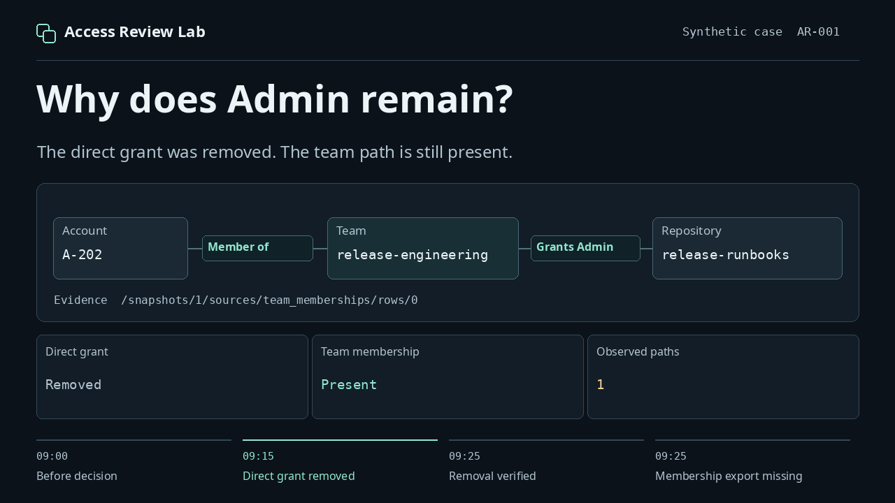

# Access Review Lab

Access Review Lab replays an identity and access management (IAM) offboarding review from timestamped exports. It checks whether a former employee's account still has a repository role and links each finding to the source records. The bundled case uses synthetic data.

[Live demo](https://xzl7v.github.io/access-review-lab/) · [Sample scenario](scenario.json) · [Evidence packet](docs/evidence.json)

## Quick start

Requires Python 3.10 or later. The CLI and tests use the standard library.

```sh
git clone https://github.com/xzl7v/access-review-lab.git
cd access-review-lab
python3 replay.py
python3 replay.py --verify docs/evidence.json
```

The replay prints one verdict per snapshot and the source references for any matching grant path. Use `--scenario PATH` to review a different input. An invalid scenario or mismatched evidence packet exits with status `2`.

## Sample case

Case `AR-001` tracks the `Admin` role for account `A-202` on `release-runbooks`. The two 09:25 snapshots show alternative follow-ups.

| Time (UTC+03:00) | Finding | Evidence |
| --- | --- | --- |
| 09:00 | Access detected | A direct grant and a team membership both grant Admin after departure. |
| 09:15 | Still granted | The direct grant is gone. Team membership still grants Admin. |
| 09:25 | Verified removed | Complete exports show no direct grant or team path to Admin. |
| 09:25 | Verification pending | The direct grant check returns zero. The team membership export is missing. |



## Evidence model

The baseline must show the scoped grant at or after departure and before the recorded revocation decision. Follow-up snapshots must cover the same repository and occur after that decision.

A matching path confirms that access remains. Verifying removal requires zero matching paths and complete exports from every required source. Each export specifies a boolean `complete` flag and a `rows` array.

| Source | Required row fields |
| --- | --- |
| `direct_grants` | `account_id`, `repository`, `role` |
| `team_memberships` | `account_id`, `team_id` |
| `team_grants` | `team_id`, `repository`, `role` |
| `team_links` | `child_team_id`, `parent_team_id` in nested team mode |

Set `team_model` to `"nested"` in the case to evaluate inherited team grants. The replay rejects cyclic team relationships and duplicate rows. The example input defines the case and snapshot schema. [Sample scenario](scenario.json)

The evidence packet records the reviewer decision, grant paths, source coverage, JSON references, and the SHA-256 hash of the normalized input.

```sh
python3 replay.py --output output/evidence.json
python3 replay.py --ledger output/reviews.sqlite
```

The SQLite ledger stores decisions and evidence packets locally. Replaying the same case and decision with identical evidence keeps a single copy of each record.

## Development

```sh
python3 -m unittest discover -s tests -v
python3 build_demo.py --check
```

Run `python3 build_demo.py` after changing the sample scenario or demo template. Open [docs/index.html](docs/index.html) in a browser to use the demo offline. CI runs the tests, checks the generated demo, and verifies the bundled evidence packet. [CI workflow](.github/workflows/ci.yml)
